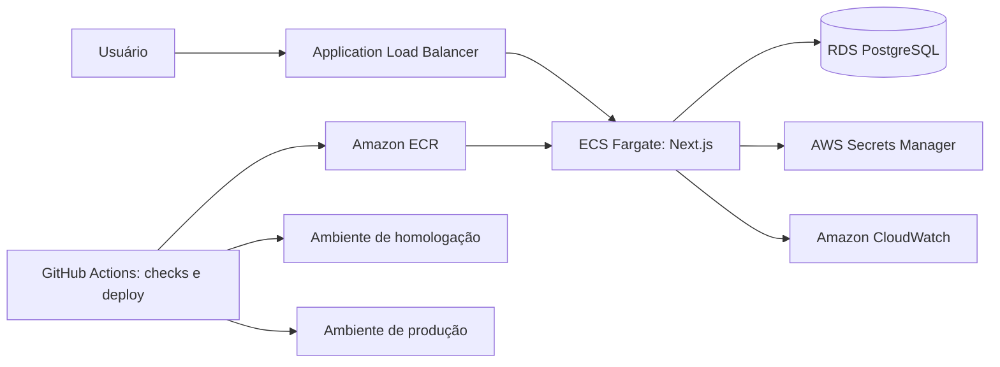

# Reserva de Salas

Aplicação web para consulta e reserva de salas de reunião, desenvolvida como desafio técnico Full Stack Pleno da Sensedia. O projeto está em desenvolvimento; esta documentação distingue o que já existe do que ainda precisa ser entregue.

## Stack

- Next.js 16 com App Router e React 19
- TypeScript em modo `strict`
- Prisma ORM 7 e SQLite para persistência local
- Zod para validação de dados
- TanStack Query para consultas no cliente
- Tailwind CSS e componentes Base UI/shadcn
- pnpm como gerenciador de pacotes

## Implementado

### SALA-1: listagem e filtros

- Lista salas com capacidade igual ou superior ao valor informado.
- Filtra por todos os recursos selecionados.
- Mantém capacidade e recursos na URL, permitindo recarregar e compartilhar os filtros.
- Exibe os resultados em cards, com estados de carregamento, erro e lista vazia.
- Consulta os dados pela API e mantém cache no cliente com TanStack Query.

### Base de dados e APIs

- Modelos Prisma para usuários, salas e recursos, com relacionamento muitos-para-muitos entre salas e recursos.
- API de listagem e criação de salas, além de atualização e exclusão por identificador.
- API de listagem e criação de recursos, além de exclusão por identificador.
- Validação de entradas com schemas Zod e respostas HTTP para dados inválidos ou registros inexistentes.

Os endpoints de criação, edição e exclusão são uma base de backend; isso não significa que os fluxos de administração e as permissões exigidas pelo desafio estejam concluídos.

## Status do desafio

| Requisito | Situação atual |
| --- | --- |
| SALA-1: listar salas e filtrar por capacidade/recurso com filtros na URL | Implementado |
| SALA-2: criar reservas, validar sobreposição, passado e duração | Pendente |
| SALA-3: listar e cancelar somente as próprias reservas | Pendente |
| SALA-4: administração de salas protegida por papel/permissão no servidor | Parcial: há endpoints de sala, mas faltam autenticação, autorização e fluxo administrativo completo |
| SALA-5: restringir reservas a dias úteis, entre 08h e 20h | Pendente |
| SALA-6: duração máxima de reserva configurável por sala | Pendente |
| Seed com cinco salas, dois usuários comuns e um administrador | Implementado |
| Testes automatizados dos requisitos pedidos | Pendente |
| CI e processo completo de branches, PRs e releases | Pendente |

As páginas de login, usuários e reservas ainda são placeholders. A tela de login não implementa autenticação ou seleção de usuário.

## Executar localmente

Requisitos: Node.js compatível com o projeto e pnpm.

1. Instale as dependências com `pnpm install`.
2. Crie um arquivo `.env` na raiz do projeto e configure `DATABASE_URL="file:./dev.db"`.
3. Aplique as migrations e crie o banco local com `pnpm exec prisma migrate dev`.
4. Gere o Prisma Client com `pnpm exec prisma generate`.
5. Popule o banco com os dados iniciais usando `pnpm exec prisma db seed`.
6. Inicie a aplicação com `pnpm run dev`.

Também estão configurados `pnpm run lint` e `pnpm run typecheck`. Ainda não há script de testes no `package.json`.

## Arquitetura AWS proposta

Esta é uma proposta para produção, não uma infraestrutura já implantada. A aplicação Next.js poderia rodar em serviços ECS Fargate atrás de um Application Load Balancer. O banco de produção seria um RDS PostgreSQL privado; o SQLite permaneceria restrito ao desenvolvimento local. Segredos ficariam no AWS Secrets Manager, logs e métricas no CloudWatch, e GitHub Actions executaria lint, typecheck e testes antes de publicar a imagem no ECR e atualizar ambientes separados de homologação e produção. Cada ambiente teria seu próprio serviço e banco.

## Próximos passos

1. Implementar reservas e suas validações no servidor.
2. Implementar identificação de usuário e autorização administrativa no servidor.
3. Implementar SALA-5 e SALA-6, CI e o fluxo de releases solicitado.
4. Criar testes automatizados para os requisitos do desafio.