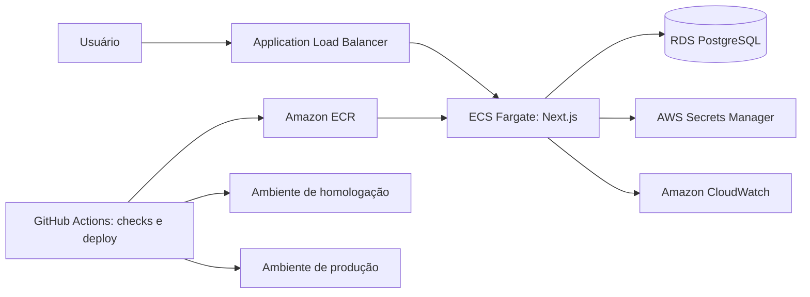

# Reserva de Salas

Aplicação web para consulta e reserva de salas de reunião, desenvolvida como desafio técnico Full Stack Pleno da Sensedia. O projeto está em desenvolvimento; esta documentação distingue o que já existe do que ainda precisa ser entregue.

## Stack

- Next.js 16 com App Router e React 19
- TypeScript em modo `strict`
- Prisma ORM 7 e SQLite para persistência local
- Zod para validação de dados
- TanStack Query para consultas no cliente
- Tailwind CSS e componentes Base UI/shadcn
- pnpm como gerenciador de pacotes

## Implementado

### SALA-1: listagem e filtros

- Lista salas com capacidade igual ou superior ao valor informado.
- Filtra por todos os recursos selecionados.
- Mantém capacidade e recursos na URL, permitindo recarregar e compartilhar os filtros.
- Exibe os resultados em cards, com estados de carregamento, erro e lista vazia.
- Consulta os dados pela API e mantém cache no cliente com TanStack Query.

### SALA-2: reservas

- Permite escolher sala, data, início e fim pelo formulário de criação de reserva.
- Consulta os períodos livres da sala para a data escolhida e os exibe no formulário.
- Cria reservas pela API com validação no servidor: início no futuro, em dia útil, entre 08h e 20h, duração mínima de 15 minutos, limite máximo definido por sala e sem sobreposição com outra reserva ativa.
- Usa React Hook Form e Zod para validar o formulário no cliente; o servidor valida novamente antes de persistir.
- Associa a reserva ao usuário obtido da sessão no servidor; o cliente não escolhe nem envia o usuário responsável.
- Mantém a consulta de disponibilidade vinculada à sala e ao período selecionados.

O período disponível exibido é informativo; o `POST` revalida conflitos para cobrir reservas criadas após a consulta.

### SALA-3: minhas reservas

- Lista as reservas do usuário autenticado, incluindo sala e recursos, com filtro por data.
- A API sempre obtém o usuário da sessão e limita a busca por `userId`; não aceita um usuário arbitrário enviado pelo cliente.
- Permite cancelar reservas próprias. O servidor verifica a propriedade e impede cancelar uma reserva em andamento.

### SALA-4: administração de salas

- Restringe as páginas de listagem, criação e edição ao papel `admin` no servidor.
- Protege operações de criação, edição e exclusão de salas e gerenciamento de recursos nas APIs, verificando sessão e papel.
- Permite criar e editar nome, capacidade e recursos. Recursos novos podem ser criados durante o cadastro/edição e relacionados à sala; nomes existentes são reutilizados.
- A API de exclusão de salas existe, mas a interface atual não apresenta uma ação para excluir uma sala.

### SALA-5: horário permitido para reservas

- Reservas só podem começar e terminar de segunda a sexta-feira, dentro da janela das 08h às 20h, no fuso `America/Sao_Paulo`.
- O calendário desabilita fins de semana e os campos de horário indicam os limites permitidos.
- A disponibilidade é consultada somente dentro da janela comercial; a API de criação valida a regra novamente no servidor.

### SALA-6: duração máxima por sala

- Cada sala tem uma duração máxima de reserva configurável em minutos. Salas existentes recebem 240 minutos por padrão para preservar o limite anterior.
- O formulário administrativo permite definir esse valor ao criar ou editar a sala.
- O formulário de reserva valida a duração conforme a sala selecionada, e a API repete a validação no servidor usando o valor persistido.

### Autenticação atual

- O login de demonstração permite escolher um usuário cadastrado, cria uma sessão de 24 horas e grava o token em cookie `HttpOnly`; o banco armazena o hash do token.
- O logout remove a sessão e o cookie. As APIs protegidas identificam o usuário no servidor e aplicam autorização por papel quando necessário.
- Este fluxo não comprova a identidade da pessoa: não há senha, SSO ou outro fator de autenticação, e a lista de usuários usada na tela de login é pública. Portanto, a seleção do perfil `admin` é apenas para demonstração e não deve ser considerada autenticação segura para produção.

### Base de dados e APIs

- Modelos Prisma para usuários, sessões, salas, recursos e reservas, com relacionamento muitos-para-muitos entre salas e recursos e relações de reserva com sala e usuário.
- API de listagem e criação de salas, além de atualização e exclusão por identificador; mutações exigem papel `admin`.
- API de listagem e criação de recursos, além de exclusão por identificador; operações administrativas exigem papel `admin`.
- API de consulta de disponibilidade, criação/listagem de reservas próprias e cancelamento de reserva própria.
- API de login, logout e consulta da sessão atual. A listagem de usuários é usada pelo login de demonstração.
- Validação de entradas com schemas Zod e respostas HTTP para dados inválidos ou registros inexistentes.

## Status do desafio

| Requisito | Situação atual |
| --- | --- |
| SALA-1: listar salas e filtrar por capacidade/recurso com filtros na URL | Implementado |
| SALA-2: criar reservas, validar sobreposição, passado e duração mínima | Implementado |
| SALA-3: listar e cancelar somente as próprias reservas | Implementado no cliente e no servidor |
| SALA-4: administração de salas protegida por papel/permissão no servidor | Implementado |
| SALA-5: restringir reservas a dias úteis, entre 08h e 20h | Implementado e testado |
| SALA-6: duração máxima de reserva configurável por sala | Implementado; valor em minutos e validação no servidor |
| Seed com cinco salas, dois usuários comuns, um administrador e recursos | Implementado |
| Autenticação simples (seleção de perfil para demonstração) | Implementado |
| Testes automatizados dos requisitos pedidos | Parcial; `pnpm test` cobre a regra de horário da SALA-5 |
| CI e processo completo de branches, PRs e releases | Em andamento |

## Executar localmente

Requisitos: Node.js compatível com o projeto e pnpm.

1. Instale as dependências com `pnpm install`.
2. Crie um arquivo `.env` na raiz do projeto e configure `DATABASE_URL="file:./dev.db"`.
3. Aplique as migrations, gere o Prisma Client e popule o banco com `pnpm run db:setup`.
4. Inicie a aplicação com `pnpm run dev`.

Também estão configurados `pnpm run lint` e `pnpm test`. Os testes atuais cobrem a regra de horário da SALA-5; os demais requisitos ainda precisam de cobertura automatizada.

## Arquitetura AWS proposta

Esta é uma proposta para produção, não uma infraestrutura já implantada. A aplicação Next.js poderia rodar em serviços ECS Fargate atrás de um Application Load Balancer. O banco de produção seria um RDS PostgreSQL privado; o SQLite permaneceria restrito ao desenvolvimento local. Segredos ficariam no AWS Secrets Manager, logs e métricas no CloudWatch, e GitHub Actions executaria lint, typecheck e testes antes de publicar a imagem no ECR e atualizar ambientes separados de homologação e produção. Cada ambiente teria seu próprio serviço e banco.

## Próximos passos

1. Criar testes automatizados e configurar CI para lint, typecheck e testes.